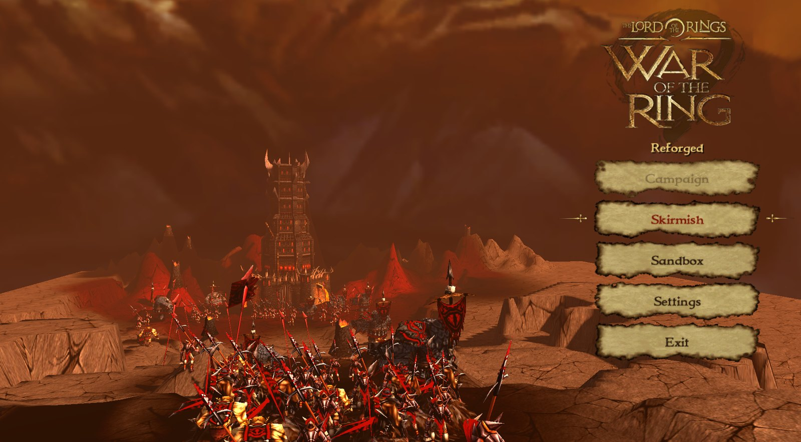
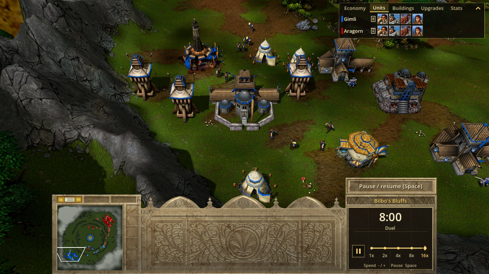
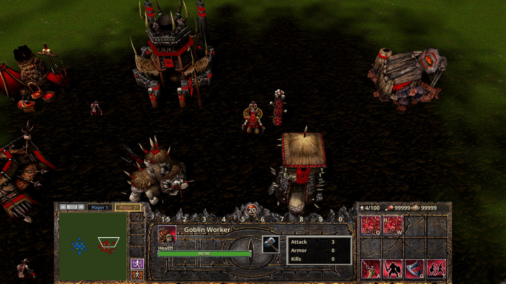
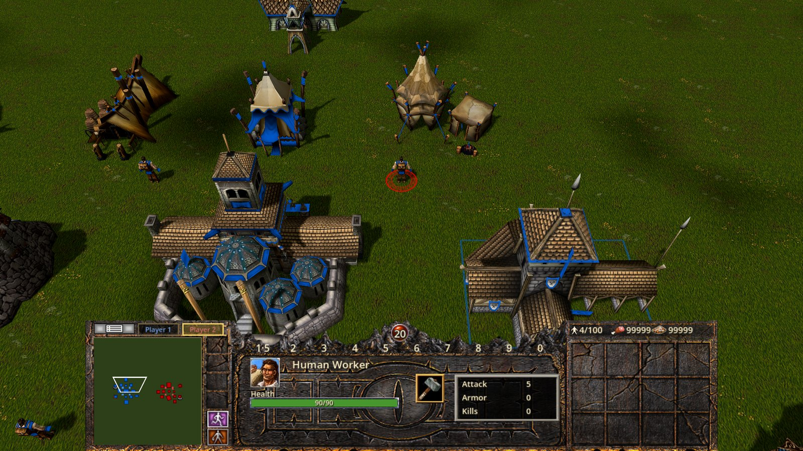
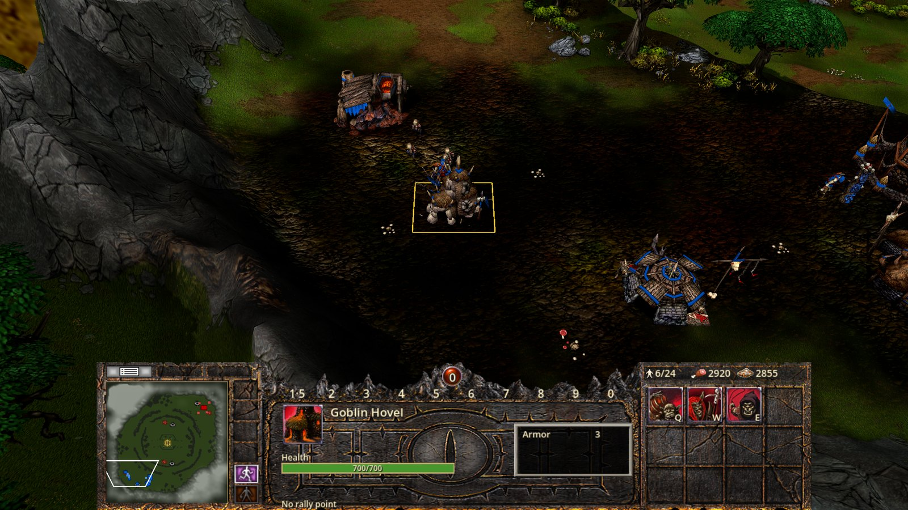
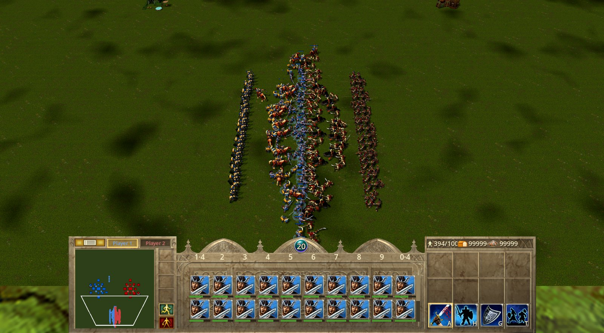
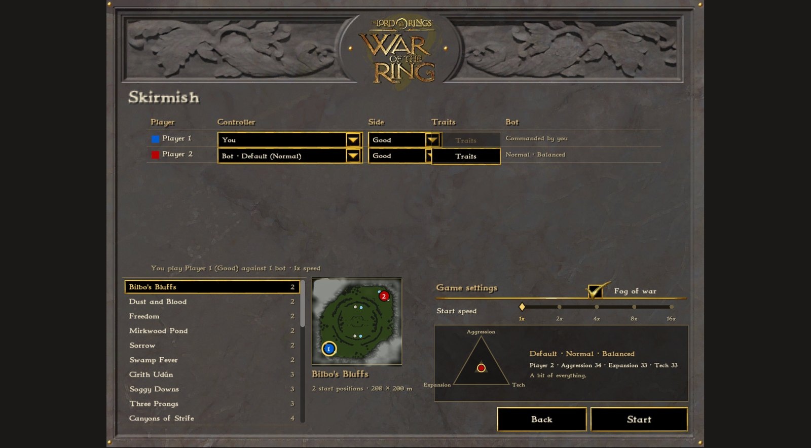

# War of the Ring Reforged

<p align="center">
  
</p>

A from-scratch remake of **The Lord of the Rings: War of the Ring** (Liquid Entertainment, 2003),
the real-time strategy game, on a new engine built with Godot 4 and C#. It plays from your own
installed copy of the original: maps, units, models, sounds and text are read straight from the
install as you play, and nothing is copied out of it or changed.

Unofficial, non-commercial fan project. It contains no game content and needs a legally obtained
copy of the original game — see [NOTICE.md](NOTICE.md).

## Progress

> [!WARNING]
> ### Status: not in active development
> The project is paused where it stands; see [Why this exists](#why-this-exists). Forks, issues and
> pull requests are still welcome.

| Part | Progress | Where it stands |
| --- | --- | --- |
| Engine |  | Reads the original's archives, database, models, maps, audio and text; deterministic simulation, rendering, fog of war, HUD, menus and launcher. Works, needs polishing. |
| Campaign |  | Not started. |
| Skirmish |  | The install's maps against bots, as Good or Evil: economy, construction, research, heroes, abilities, places of power. Playable, needs polishing. |
| Multiplayer |  | Not started. |

## Why this exists

This was an experiment during the boom of "reverse engineer everything with AI". I wanted to take
a dead game — one that doesn't run well on modern systems and lacks many of the features we've got
used to in modern RTS games — and remake it from scratch on a different engine.

I spent several weeks on this project, and I remember how amazed I was on the second day of
development, when I already had a playable prototype. However, the more days I spent on it, the
clearer it became that I wouldn't be able to fully finish it: there are so many details to
reproduce to make a 1-to-1 copy of the original game. And I can't spend more time on it — I'm just
a working father with a $20 Claude subscription, not some AI power user with endless free time,
ready to decompile GTA 6 or something.

So for now I've stopped where I am: I've mostly built the engine and the Skirmish mode. It works
nicely, but still needs some polishing. I'll keep this project public — if anyone wants to use or
expand it, I'm happy to support.

## Screenshots

<table>
  <tr>
    <td width="50%"><br>
      <sub>Bilbo's Bluffs, eight minutes into a match between two bots, watched as an observer.</sub></td>
    <td width="50%"><br>
      <sub>An Evil base on the ground its War Posts corrupt, with the Evil console.</sub></td>
  </tr>
  <tr>
    <td><br>
      <sub>The Good side's Citadel and buildings, a worker selected.</sub></td>
    <td><br>
      <sub>Playing Evil on Bilbo's Bluffs: the corruption spreads under the base.</sub></td>
  </tr>
  <tr>
    <td><br>
      <sub>300 soldiers in one melee: the stress benchmark in the Sandbox.</sub></td>
    <td><br>
      <sub>Skirmish setup: the install's 33 maps, bots with difficulty, style and traits.</sub></td>
  </tr>
</table>

Every picture is the engine running with the owner's copy of the game; the art is the
original's, read from the install as the game plays.

## Getting started

**You need** Windows 10 or 11 (64-bit) and your own installed copy of *The Lord of the Rings: War
of the Ring*. English and Russian installs have been tested. Nothing else: .NET is included.

1. Download the newest `WarOfTheRingReforged-build-<N>-win64.zip` from
   [Releases](https://github.com/genikaro/war-of-the-ring-reforged/releases).
2. Unzip it anywhere, but not inside the original game's folder.
3. Run `WarOfTheRingReforged.exe`.
4. The launcher looks for your game. If the game folder is empty, click **Browse** and pick the
   folder that has `Archives` and `Database` in it.
5. Click **Start Reforged**, then choose **Skirmish** in the main menu.

The launcher remembers your game folder next time. The controls are those of a classic RTS; the
full list is in [docs/README.md](docs/README.md#controls).

**Something went wrong?** Start `WarOfTheRingReforged.console.exe` instead to see the log, and
[open an issue](https://github.com/genikaro/war-of-the-ring-reforged/issues) with the build number
(it's in the zip's name) and `logs\godot.log` from
`%APPDATA%\Godot\app_userdata\War of the Ring Reforged — Prototype`. Deleting that folder resets
all settings; nothing is ever written into the game's folder.

## Debug mode

Debug mode unlocks the testing tools. Start the game with `-Debug`:

```powershell
.\WarOfTheRingReforged.exe -Debug
```

In debug mode:

- The main menu has a **Sandbox**, a test map where you command both sides (**Tab** switches
  between them).
- The top-right corner shows the build number, date and FPS.
- **F4**, or the **Debug · F4** button at the top right, opens the debug tools. Opening them does
  not pause the game:
  - **Pause** and **Step one tick** (50 ms) to go through the simulation tick by tick.
  - **Restart encounter**, and **Skirmish setup** to go back to the setup screen with the same
    choices.
  - **Show unit current action**: the selected unit's current order, shown beside its portrait.
  - **Cheats**: +1000 food and ore and +10 Fate, instant building and training, and **Reveal
    map** (the bots still know only what they have seen).

**F10** hides or shows the whole interface, in any mode, which is handy for screenshots.

## Building from source

You need Windows, [Godot 4.7.2 .NET](https://godotengine.org/download/windows/) and the .NET 10
SDK. Python 3.13 with Pillow and NumPy is only needed for the format tools in `tools/`.

Run the game from source (the main menu; `-Launcher` opens the launcher instead, `-Debug` starts
in debug mode and `-DebugMenu` also opens the debug tools). A run from source starts muted;
`-Unmuted` turns the sound on:

```powershell
./prototype/run.ps1 -Install "C:/Games/War of the Ring"
```

Build `WarOfTheRingReforged.exe` into `build/`. The first time, `-DownloadTemplates` also fetches
Godot's export templates (about 1.2 GB); `-Release` packs the release zip into `build/release/`:

```powershell
./prototype/export.ps1 -DownloadTemplates
./prototype/export.ps1 -Release
```

Run the checks (the simulation checks need no install):

```powershell
dotnet run --project tests/simulation -c Release
dotnet run --project tests/formats -c Release -- --install "C:/Games/War of the Ring"
./prototype/run.ps1 -SkirmishSmoke
python -m pytest tools
```

Every switch, smoke and capture is described in [docs/README.md](docs/README.md#run).

## Repository layout

| Path | Contents |
| --- | --- |
| `prototype/` | Godot 4 C# project: simulation core, rendering, HUD, launcher, readers for the original formats (`Formats/`), the builders that make the game's rules, models, pictures, audio and maps from the install in memory (`Install/`), `run.ps1`, `export.ps1` |
| `tools/` | Python and JavaScript readers and analysis for the original game's formats: the reference the C# is checked against |
| `tests/` | C# simulation, movement, combat and repeatability checks, and checks that the C# readers equal the Python ones |
| `docs/` | All project documentation, starting with [docs/README.md](docs/README.md) |
| `LICENSE`, `NOTICE.md` | GPL-3.0-or-later, and what it does and does not cover |

## Documentation

Everything is in [`docs/`](docs/): the [build log, setup and controls](docs/README.md), the
[roadmap](docs/ROADMAP.md), the [asset tools](docs/TOOLS.md) with their format notes
(`docs/NOTES-*.md`), and one document per system — [skirmish](docs/SKIRMISH.md),
[combat](docs/COMBAT.md), [commands](docs/COMMANDS.md), [movement](docs/MOVEMENT.md),
[abilities](docs/ABILITIES.md), [menus](docs/MENUS.md), [localization](docs/LOCALIZATION.md),
[performance](docs/PERFORMANCE.md) and the rest. Some documents mention the author's
original-game research notes; those stay local and are not part of the repository.

## Contributing

Forks, fixes and new features are welcome. Open an
[issue](https://github.com/genikaro/war-of-the-ring-reforged/issues) or a pull request; the
[roadmap](docs/ROADMAP.md) lists what is missing. Contributions are accepted under the project's
license, GPL-3.0-or-later.

## License

GNU General Public License v3.0 or later, for the code and documentation written for this
project. See [LICENSE](LICENSE) and, for the original game's content and marks,
[NOTICE.md](NOTICE.md).
