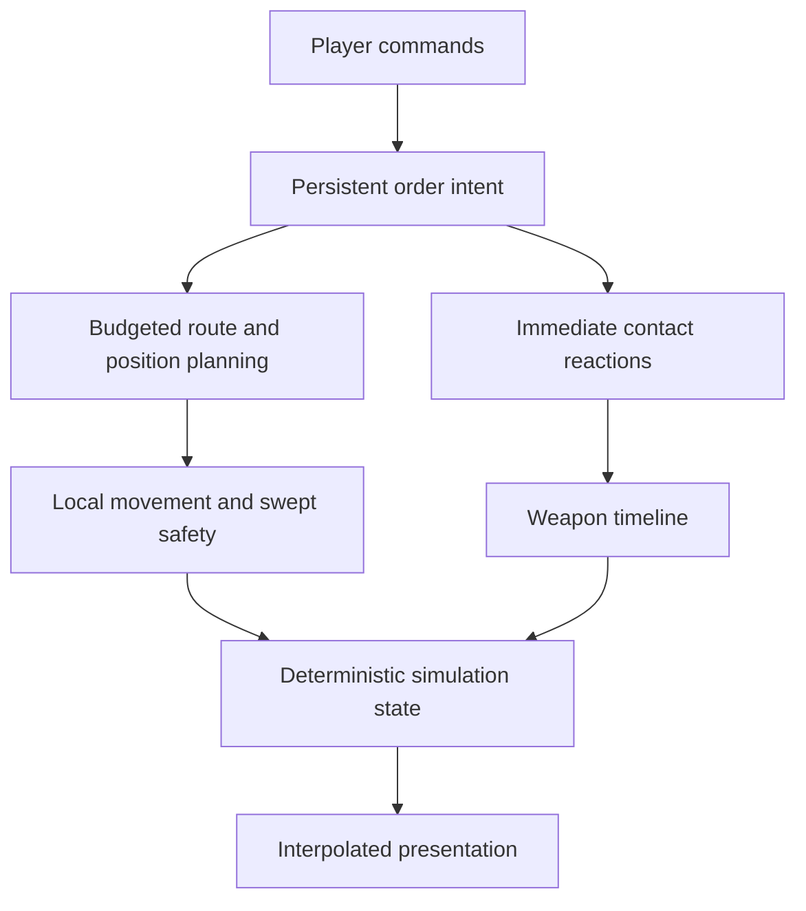

# RTS movement and combat: research, implementation, and limits

Research date: 24 October 2026. Implementation: build-64.

The recommended architecture separates command intent, terrain routing, local movement,
combat positioning, weapon execution, and presentation. Our existing deterministic C#
simulation is a useful foundation. Replacing it with one Godot physics body or navigation
agent per soldier would not by itself fix crowded fights.

Build-64 implements the scheduling and spatial-query changes described below. Predictive
velocity avoidance, continuous contact positions, shared strategic routes, and rendering
LOD remain further work. The measurements establish progress; they do not establish
StarCraft II quality or thousand-unit rendering performance.



## What StarCraft II actually documents

Bob Fitch's original **Evolution of RTS AI**, AIIDE 2011, describes the fourth pathing
generation as A* with dynamic triangles/zones, variable unit sizes, and circular units.
Its group AI uses a real member as leader and takes wider paths around obstacles to
avoid feeding soldiers into defenses one at a time. Slides 29–35 distinguish this from
the preceding game's hidden captain and rigid formations. Slides 65–68 describe
cooperative time slicing and SC2's separate thinking objects. These are historical
implementation statements, not a specification of the present engine.
[Original Blizzard presentation archive](https://www.movingai.com/aiide11/BlizzardAI.zip).

James Anhalt's GDC 2011 navigation talk is another first-party source. The accessible
GDC record identifies the session and speakers, but its recording was not accessible
during this research. Consequently, this report does not assert precise funnel,
triangulation-update, or steering implementation details from that recording.
[GDC session](https://www.gdcvault.com/play/1014515/AI-Navigation-It-s-Not).

Blizzard's 5.0 engine notes document regular pathing, enemy scanning and ability checks
on game loops of 0.0625 **game seconds**, and an opt-out flag for resource objects. They
also document optional formation movement with independently moving unit speeds.
That interval must not be casually translated into wall-clock multiplayer tick rate.
[Blizzard engine notes](https://news.blizzard.com/en-us/article/23482838/starcraft-ii-5-0-patch-notes).

**Do not attribute Supreme Commander 2's flow-field implementation to StarCraft II.**
Elijah Emerson's chapter explicitly describes tiled flow fields for Supreme Commander 2.
It is a strong alternative architecture, not evidence that Blizzard used the same one.
[Emerson, Game AI Pro, chapter 23](https://www.gameaipro.com/GameAIPro/GameAIPro_Chapter23_Crowd_Pathfinding_and_Steering_Using_Flow_Field_Tiles.pdf).

The useful lesson is layered control and predictable player intent. A crowd solver,
formation controller, opponent AI, and weapon system solve different problems.

## Modern practice and the decisions for this project

### Commands and timing

Apply player orders on the next fixed simulation tick. Interrupt the unit's old intent
immediately; retain weapon recovery so Stop/Attack spam cannot manufacture damage.
Run local safety, contact reactions and weapon events every tick. Schedule costly
route searches and tactical reassignment separately. A soldier with a usable path
continues along it while a replacement waits.

Keep rendering independent of simulation ticks and interpolate the recorded movement
segments. Glenn Fiedler explains the fixed-step accumulator, interpolation and the
need for simulation headroom to avoid a catch-up spiral.
[Fix Your Timestep](https://gafferongames.com/post/fix_your_timestep/).

Our 20 Hz tick gives a nominal 0–50 ms command admission interval at normal game speed,
before presentation and device latency. Increasing this rate would also require
reconciling imported animation hit ticks, cooldowns, economy and replays. It should be
a measured migration, not a global constant change.

For a modern reference, Frost Giant stated that SnowPlay used 64 ticks and targeted
over 1,000 on-screen units in its GDC 2024 overview. These are the developer's claims,
not independently measured guarantees. They show that responsiveness deserves an
explicit budget alongside maximum unit count.
[Frost Giant, GDC 2024](https://playstormgate.com/news/first-look-at-the-stormgate-editor-at-gdc).

### Terrain routing

Route over static terrain and building footprints with body clearance. Use local
movement to negotiate other soldiers. Rebuild routes after meaningful destination,
topology or progress changes; an enemy moving a few millimeters is not sufficient.
Godot's documentation specifically cautions against resetting every agent's path
every frame or doing a reachability search immediately before another path search.
[Godot navigation performance](https://docs.godotengine.org/en/stable/tutorials/navigation/navigation_optimizing_performance.html).

| Technique | Good fit | Decision here |
|---|---|---|
| Body-aware grid A* and shortcuts | Existing maps, layered decks, modest groups | Retain and improve |
| Hierarchical cluster/portal routes | Large maps and long journeys | Next routing experiment |
| Navmesh plus corridor following | Broad open geometry with relatively few portals | Viable future backend; benchmark conversion and dynamic buildings first |
| Shared reverse search / tiled flow fields | Many soldiers sharing a destination and clearance profile | Add for army travel when repeated long routes dominate profiling |
| JPS | Uniform-cost regular grids with appropriate movement rules | Not a direct replacement for our layered, body-dependent graph |
| Full cooperative space-time paths | Trains, narrow lanes, strict reservations | Restrict to bottlenecks, not every open-field soldier |

HPA* reduces search by connecting precomputed local clusters through an abstract graph;
local changes can update the affected abstraction. This matches our grid investment
better than an immediate full navigation rewrite.
[Botea, Müller and Schaeffer, HPA*](https://webdocs.cs.ualberta.ca/~mmueller/ps/2004/hpastar.pdf).
JPS's original correctness and performance results concern uniform-cost grid environments.
They do not automatically cover our extra layers, clearance and runtime footprint rules.
[Harabor and Grastien, JPS](https://pathfinding.ai/pdf/harabor-grastien-aaai11.pdf).

For shared routes, key caches by body clearance, navigation revision and destination
region. Keep local terminal positions private to each soldier. Give different destinations
different fields; otherwise the memory cost can grow as map cells times active goals.
Fieldrunners 2's implementation explicitly discusses that tradeoff.
[Pentheny, Game AI Pro, chapter 24](https://www.gameaipro.com/GameAIPro/GameAIPro_Chapter24_Efficient_Crowd_Simulation_for_Mobile_Games.pdf).

### Local movement and crowd flow

Use an indexed neighborhood and a short predictive horizon. The desired velocity comes
from route progress, while local avoidance chooses a feasible velocity near it.
Keep a passing side across ticks. Include slowing and stopping among the candidates;
turning at full speed is not always the best answer. Treat Hold Position and a fighter
committed to a swing as stationary constraints.

Reynolds separates action selection, steering and locomotion, and describes arrival
alongside avoidance and flocking. Simple attraction without arrival can produce orbiting.
[Reynolds, steering behaviors](https://www.red3d.com/cwr/papers/1999/gdc99steer.html).

ORCA assigns reciprocal responsibility for avoiding another agent and solves velocity
constraints near the preferred velocity. Its authors demonstrate substantial crowd sizes.
Those guarantees depend on the model and executed motions; arbitrary post-processing,
teleports, incompatible constraints or ignoring neighbors can invalidate them.
[ORCA authors and paper](https://gamma-web.iacs.umd.edu/ORCA/).

For our deterministic implementation, compare two prototypes behind the same interface:
an integer sampled-velocity solver and a carefully quantized ORCA implementation. The
sampled solver can evaluate a small set of headings and speeds against closest approach:

```text
r = other.position - self.position
v = candidate.self_velocity - other.velocity
t = clamp(dot(r, v) / dot(v, v), 0, horizon)
predicted_gap_squared = dot(r - v*t, r - v*t)
```

Use a separate zero-relative-speed case. Score progress, collision time, heading change,
clearance and the established passing side. Retain exact terrain and swept body checks
after choosing velocity. The predictive solver improves choices; the sweep remains the
final safety check. All scoring and tie-breaking must be deterministic.

Godot documents that avoidance operates separately from navmesh/physics geometry, that
long horizons can cause excessive slowing, and that perfectly symmetric encounters can
fail to establish a passing side. Therefore simply enabling engine RVO is insufficient.
[Godot avoidance behavior and limits](https://docs.godotengine.org/en/stable/tutorials/navigation/navigation_using_navigationagents.html#navigationagent-avoidance).

Open-field separation should not become a long-range repulsion force. That makes armies
inflate, prevents melee contact and causes units to oscillate between attraction and
repulsion. Use strong short-range safety and weaker, bounded comfort spacing. At a choke,
reduce formation width and use explicit yielding rather than repeated sideways sampling.

### Logical combat positioning

Keep the player's order target separate from the temporary opponent used to reach a
fight. Preserve Force Attack, Hold, Guard leashes and queued-order completion. Finish
active swings unless an explicit player interrupt, invalid victim or range failure
requires cancellation. Automatic kiting or excessive target switching can take control
away from the player.

For melee, a target is a contact region with finite accessible frontage. Candidate
positions need valid terrain, enemy-body clearance, approach access, and reservations
against other approaching allies. For ranged units, use a valid firing annulus with
minimum range, maximum range and line of fire. Once a firing position works, keep it
until a meaningful event invalidates it. A ranged soldier should not walk into melee
merely to improve a tiny target-score difference.

Attack and approach capacity can be managed separately. Michael Dawe describes this
distinction and inner/outer positions for an action game. For our RTS, adapt the capacity
concept to physical access; do not import artificial attack-turn limits as game balance.
[Dawe, Game AI Pro, chapter 28](https://www.gameaipro.com/GameAIPro/GameAIPro_Chapter28_Beyond_the_Kung-Fu_Circle_A_Flexible_System_for_Managing_NPC_Attacks.pdf).

The next contact-position implementation should use continuous candidate points rather
than requiring cell centers. Claim one point per approach, expire abandoned claims,
and release them on death/order changes. Reuse working claims with positional hysteresis.
Choose alternatives by travel cost, local congestion and accessible frontage. A rear
soldier may wait when frontage is genuinely full, and advances when a casualty opens it.
It should not circle indefinitely around an unreachable exact slot.

For optional ranged target distribution, track damage already committed by projectiles
and swings so automatic selection avoids extreme overkill. Keep explicit focus-fire
orders authoritative. This policy is proposed, not implemented in build-64.

### Performance and determinism

Spatial indexing should cover bodies, destination reservations and exceptional long
links separately. A point-only neighborhood query can otherwise omit a reserved deck
crossing or a body that moved earlier in the same tick. Never cap the exact collision
safety check to an arbitrary number of neighbors. Cap predictive steering work if
necessary, with the exact sweep still enforcing safety.

Use reusable buffers in hot local checks. Cache terrain geometry separately from live
occupancy and targeting. Avoid rebuilding a world-sized occupied-node set for each local
shortcut. Keep candidate sorting deterministic, including equal-cost cases.

Budget search work in nodes and requests rather than milliseconds. Slow hardware must
not choose different opponents or hit results. If multithreading becomes necessary,
read an immutable tick snapshot, write individual intentions, then resolve and commit
in a stable order. Moving our current mutating unit loop onto parallel workers would
introduce races and order-dependent collisions.

Supreme Commander engineer Forrest Smith describes why synchronized RTS simulations
need identical state transitions and state hashes, with a separate presentation layer.
That is direct experience with Supreme Commander, not proof of every SC2 engine detail.
[Smith, synchronous RTS engines](https://www.forrestthewoods.com/blog/synchronous_rts_engines_and_a_tale_of_desyncs/).

## What the code audit found

The project already had fixed integer ticks, imported weapon timings, body-specific
navigation, local passing-side memory, target load balancing, and presentation
interpolation. The principal issues found were:

1. `CombatPlanningTurn` used the total historical unit count, granting three ID slots
   per tick even when those units were dead, working, or needed no plan. With 300
   unrelated corpses, a newly ordered fighter could wait many ticks for its ID's turn.
2. `RedirectCrowdedAttacker` could try twelve full combat-position searches in one turn.
   A limit on planning **units** therefore did not limit actual search work.
3. Ground movement and combat stepping repeatedly scanned the whole army. Target load
   scoring also counted the full unit list for every potential opponent.
4. Attack positions were spatially separate from bodies but had no independent spatial
   index. Optimizing only body queries would silently miss distant reservations.
5. Combat candidate enumeration repeated the same terrain ring around stationary targets.
6. Shortcut evaluation built global occupied-node sets even for short local routes.
7. The existing 18-vs-18 synthetic infantry test passed, so it could not characterize
   large mixed armies or distinguish scheduling delay from rendering and contact behavior.

## Implemented in build-64

`CombatPlanning.cs` grants up to six imported-body combat searches per tick to actual
pending requests, oldest first with ID tie-breaking. New requests use spare tokens
immediately. Each unit gets at most one attempt per tick. Failed alternative approaches
advance through a bounded candidate list across later turns instead of restarting with
the same inaccessible opponent or trying twelve searches in a burst.

Pending demand must be renewed while a unit still needs planning. Extended simulations
found that a failed alternative search could leave an obsolete request behind after
the existing route became usable again. Tick-boundary cleanup now expires those stale
requests, and the renewal timestamp participates in replay state hashes.

An explicit Attack/Force Attack with a clear terrain corridor can begin a locally checked
step while its first graph search waits. Existing routes continue. Ordinary attack-move
retains its encounter and regrouping rules. Move and Hold interrupt immediately.

`UnitGrid` now uses 4 m buckets and maintains target assignments, attack-position buckets,
and constrained-link membership as unit fields change. Movement queries include the
maximum possible travel earlier in the tick. Ground and combat sweeps reuse buffers.
Melee threat selection uses a conservative local reach bound.

Terrain candidate rings are cached by target, body graph, reach parameters, target pose
and navigation revision. The bounded cache stores geometry only; occupancy, connectivity,
attack legality and reservations are checked live. Local shortcut occupancy comes from
the route's padded bounds. Wide noncombat shortcuts use terrain clearance with local
body avoidance. Combat retains its existing occupancy-aware route policy.

The scheduler's request age and alternative cursor are included in replay state hashes.
The HUD continues to read the single `BuildInfo.Number`, now 64. No content-cache rebuild
is required.

## Measurement and acceptance

The reproducible benchmark covers 12, 36, 64 and 100 soldiers **per side**, melee and
mixed, plus a 36-vs-36 mixed choke. It uses imported Gondor Swordsman and Elven Archer
definitions on a synthetic 96 by 80 m map. HP is raised to 10,000 to keep the front
intact for 800 ticks. It is a simulation benchmark, not a GPU or rendered FPS benchmark.
Profiling is enabled in both versions. Allocations include the benchmark's observation
code. Timings below are single local Release runs, so small differences are noise.

| Per side / army / terrain | CPU ms before / after | Warm p95 ms before / after | Allocated MB before / after | Unique hitters before / after |
|---|---:|---:|---:|---|
| 12 / melee / open | 313 / 293 | 0.50 / 0.47 | 58 / 39 | 12/12 / 12/12 |
| 12 / mixed / open | 383 / 398 | 0.53 / 0.48 | 74 / 64 | 12/12 / 12/12 |
| 36 / melee / open | 1102 / 1012 | 3.36 / 2.59 | 400 / 232 | 19/17 / 21/19 |
| 36 / mixed / open | 420 / 418 | 1.05 / 0.66 | 310 / 329 | 26/28 / 26/26 |
| 64 / melee / open | 845 / 732 | 2.06 / 1.09 | 731 / 444 | 29/29 / 23/25 |
| 64 / mixed / open | 755 / 563 | 1.67 / 0.89 | 740 / 552 | 45/40 / 36/40 |
| 100 / melee / open | 1412 / 1070 | 3.30 / 1.62 | 1265 / 651 | 30/28 / 32/33 |
| 100 / mixed / open | 1579 / 1079 | 3.02 / 1.60 | 1235 / 1023 | 57/59 / 57/58 |
| 36 / mixed / choke | 297 / 305 | 0.90 / 0.47 | 319 / 329 | 24/26 / 26/26 |

The durable-front fixture intentionally limits access: every soldier cannot attack
simultaneously through the same frontage. Participation is not uniformly improved in
every formation. In particular, the 64-per-side cases still expose weaknesses in
contact positioning. Preserve these rows when evaluating the next movement solver.

Separate ordinary-health 36-vs-36 mixed armies complete their battle with all 72 units
landing hits. The queue's longest measured wait in that synthetic durable regression
is three ticks, and no tick exceeds six searches. A new explicit 36-unit attack begins
moving the whole clear-approach group on the command tick. The 300-corpses regression
also reacts on its command tick. Those are deterministic assertions rather than timing
thresholds.

The real Helm's Deep Godot attack-move smoke selects 18 allies through input, dispatches
the attack-move, checks physical separation, and records 18/17 unique hitters. The
current log and generated JSON reports live under ignored `converted/`.

Final validation passed 1,015 simulation checks with the Helm's Deep cache, the
real-map explicit-attack and attack-move engagement smokes, and the formation smoke.
The latter completes both movement orders with 18 surviving allies and no unsettled
units. The project builds successfully; the compiler still reports the existing
nullable-reference warning in `Main.Construction.cs:321`.

```powershell
./converted/tooling/dotnet/dotnet.exe run --project tests/simulation -c Release -- --cache converted/prototype
./converted/tooling/dotnet/dotnet.exe run --project tests/simulation -c Release -- --army-benchmark converted/army-build64.json converted/skirmish
./prototype/run.ps1 -AttackMoveEngagementSmoke
./prototype/run.ps1 -FormationSmoke
```

## Remaining work in priority order

1. **Predictive local movement and continuous contact positions.** Compare against these
   baselines for passing traffic, full rings, mixed combat, casualty replacement and
   immediate redirects. Retain the exact swept safety gates and command semantics.
2. **Shared long-route planning.** Add cluster/portal guidance or tiled reverse fields
   when large-map profiling shows repeated long routes. Cache by clearance and topology.
3. **Bottleneck coordination.** Queue narrow entrances with bounded yielding and recovery.
   Preserve validated layered-deck links and prevent head-on permanent deadlocks.
4. **Presentation scale.** Measure 100/200/500 rendered soldiers separately: animation
   sampling, skeletons, materials, shadows, projectiles, corpses and HUD. Introduce
   distance/visibility-based presentation updates and suitable batching where measured.

Keep a scenario matrix with clear ground, opposing traffic, stationary allies, chokes,
stairs, moving targets, newly placed buildings, disappearing targets and disconnected
islands. Record first movement, planner age, no-progress intervals, attack participation,
target changes, completed orders, collisions, allocation rate, p50/p95/p99 steps and
render frame time. Measure cold topology changes separately from warm steady-state play.
Use deterministic correctness assertions in CI and timing reports for comparison.


## Extended simulation follow-up

Validation of this same build-64 change set added 18 seeded long-run scenarios, up to
400 soldiers per side. They cover ordinary-health attrition, durable mixed fronts,
chokes, Move/Hold/Stop interruptions, Walk/Run changes, runtime obstacles, and queued
primary-target death. Across primary runs and their replays they execute 192,000 ticks,
or 160 combined simulated minutes, with 982 replay-hash checkpoints and 113,195,891
nearby body-pair checks. Body endpoints are checked every tick; quarter/mid/three-quarter
render positions and ground movement segments are checked every tenth tick.

These runs found the stale planning-demand bug described above. The seed-8 100-per-side
durable reproduction originally retained a request for 3,581 ticks; after cleanup its
longest pending request is 11 ticks. The largest 800-unit durable run's maximum is 38
ticks. All 18 cases pass after correction. The 400-per-side attrition case ends with
5/12 survivors whose orders completed beyond mutual awareness/firing range; the harness
explicitly accepts that bounded disengagement and still rejects locally unresolved combat.

The ordinary 1,015-check suite, 34 Bilbo's Bluffs worker checks, and real-map engagement
and formation smokes pass. Sandbar, Mighty Silverlode and Choke connectivity probes
also retain their expected body-size restrictions. These measurements concern simulation;
they do not establish rendered performance with 800 unit models.

Generated details and per-case provenance: `converted/build64-extended-validation.md`
and `converted/build64-extended-validation.json`. The regression remains opt-in so the
normal test command stays short:

```powershell
./converted/tooling/dotnet/dotnet.exe run --project tests/simulation -c Release -- --army-soak converted/skirmish converted/army-soak.json
```
